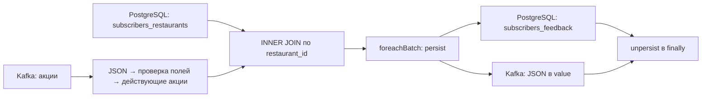

# Уведомления подписчикам об акциях ресторанов

Репозиторий проекта: [yurasunX/de-project-sprint-8](https://github.com/yurasunX/de-project-sprint-8).

Проект по потоковой обработке данных: Spark Structured Streaming читает акции из Kafka, выбирает подписчиков ресторана из PostgreSQL и записывает персональные уведомления в Kafka и таблицу обратной связи.



## Реализация

| Файл | Назначение |
|---|---|
| `src/restaurant_streaming/app.py` | SparkSession, JDBC, поток Kafka, append, checkpoint, foreachBatch |
| `src/restaurant_streaming/transforms.py` | Явная JSON-схема, фильтрация, join, выходной JSON |
| `src/restaurant_streaming/sinks.py` | Кэширование и запись одного батча в два назначения |
| `src/restaurant_streaming/config.py` | Конфигурация из переменных окружения |
| `src/restaurant_streaming/manage.py` | Подготовка БД и команды kcat |
| `sql/01_feedback.sql` | DDL таблицы назначения и уникальный ключ события |
| `sql/02_demo_subscribers.sql` | Подписки только для собственной демонстрационной БД |
| `scripts/make_message.py` | Акция с актуальными датами |
| `scripts/e2e.py` | Сквозная проверка реальных Kafka, Spark и PostgreSQL |
| `tests/` | Проверки преобразований, обработки ошибок и PostgreSQL |

Вход содержит `restaurant_id`, `adv_campaign_id`, `adv_campaign_content`, `adv_campaign_owner`, `adv_campaign_owner_contact`, `adv_campaign_datetime_start`, `adv_campaign_datetime_end`, `datetime_created`. Первые пять полей — строки, последние три — целые Unix seconds (`long`). Некорректные сообщения и пустые обязательные поля отбрасываются.

Акция действует при `start <= now < end`. Будущие акции отбрасываются при чтении; приложение не откладывает их до начала действия. Часовой пояс Spark — UTC. В результате остаются исходные восемь полей, `client_id` и `trigger_datetime_created` в Unix seconds. В Kafka отправляется ровно одна строковая колонка `value` с JSON этих десяти полей. PostgreSQL дополнительно генерирует `id`, а `feedback` изначально равен `NULL`.

Подписки материализуются и кэшируются при старте приложения. Для обновления снимка подписок требуется перезапуск. Интервал микробатча по умолчанию — 30 секунд; он настраивается через `TRIGGER_INTERVAL`.

## Запуск с учебными сервисами

Нужны Python 3.9–3.12, Java 17, kcat, PostgreSQL и доступ к своим Kafka-топикам. Зафиксированная версия Spark — 3.5.6. Установите зависимости из корня проекта:

```bash
python3 -m venv .venv
source .venv/bin/activate
pip install -e .
mkdir -p .local
cp .env.example .local/project.env
chmod 600 .local/project.env
```

Заполните `.local/project.env` параметрами своего окружения. `SOURCE_PG_*` — БД подписчиков, `FEEDBACK_PG_*` — собственная БД обратной связи. Они могут находиться на разных серверах. У пользователя назначения должны быть права на таблицу и последовательность `id`; для `init-db` также нужны права создания таблицы и индекса. Для собственной демонстрации источник и назначение могут быть одной БД.

Для текущей учебной Kafka получите параметры в [панели инфраструктуры](https://infra.education-services.ru/activate/de-kafka). Используйте выданные входной и выходной топики, логин, пароль и префикс consumer groups. Общий `persist_topic` не используется в этом проекте. Настройте:

- `KAFKA_CA_LOCATION` — абсолютный путь к выданному `cluster-ca.crt`, для kcat;
- `KAFKA_TRUSTSTORE_LOCATION` — абсолютный путь к Java truststore, для Spark;
- `KAFKA_TRUSTSTORE_PASSWORD` — пароль truststore;
- `KAFKA_GROUP_ID_PREFIX` — выданный префикс; приложение добавляет уникальный суффикс.

Создать truststore можно штатным `keytool`; он запросит пароль интерактивно:

```bash
keytool -importcert -alias course-kafka-ca -file .local/cluster-ca.crt \
  -keystore .local/kafka.truststore.jks -storetype JKS
```

Проверка доступа и подготовка назначения:

```bash
python -m restaurant_streaming.manage --env-file .local/project.env kafka metadata
python -m restaurant_streaming.manage --env-file .local/project.env init-db
```

Для собственной пустой демонстрационной БД добавьте подписки командой ниже. Не применяйте `--demo` к общему источнику курса:

```bash
python -m restaurant_streaming.manage --env-file .local/project.env init-db --demo
```

Для существующей таблицы назначения DDL создаёт уникальный индекс по `(restaurant_id, adv_campaign_id, client_id)`. Если старые данные содержат повторы этого ключа, подготовка остановится: их нужно согласованно обработать перед миграцией. Скрипт не удаляет существующие строки.

Запустите сервис в одном терминале:

```bash
python -m restaurant_streaming.app --env-file .local/project.env
```

В другом отправьте актуальную акцию через kcat. Значение `restaurant_id` должно существовать в источнике подписок; указанный UUID создан демонстрационным SQL:

```bash
python scripts/make_message.py --restaurant-id 123e4567-e89b-12d3-a456-426614174000 \
  | python -m restaurant_streaming.manage --env-file .local/project.env kafka produce
python -m restaurant_streaming.manage --env-file .local/project.env kafka consume --topic output
```

Команда `manage kafka produce` запускает установленный kcat с приватным временным конфигурационным файлом. Пароли не передаются аргументами процесса. `make_message.py --with-key` предназначен для самостоятельного вызова `kcat -K:`; обычная команда выше отправляет JSON без ключа.

Проверьте строки в PostgreSQL:

```sql
SELECT restaurant_id, adv_campaign_id, client_id, trigger_datetime_created, feedback
FROM public.subscribers_feedback
ORDER BY id DESC LIMIT 20;
```

Для разового выполнения с завершением используйте `--once`: Spark обработает доступные сообщения и сохранит прогресс в checkpoint. При обычном перезапуске сохраняйте тот же путь checkpoint. `KAFKA_STARTING_OFFSETS` действует только для нового checkpoint. Одновременно запускать два приложения с одним checkpoint нельзя.

## Проверки

```bash
python -m unittest discover -s tests -v
python scripts/e2e.py --env-file .local/project.env
```

Сквозной сценарий выбирает существующий ресторан, отправляет через kcat активную, будущую и завершённую акции с уникальными идентификаторами, запускает настоящий поток Spark и сверяет оба назначения. Ожидается доставка только активной акции каждому подписчику, точная схема JSON и `feedback IS NULL`. Он использует отдельный checkpoint, оставляет тестовые события в личных топиках/своей БД и сохраняет отчёт без секретов в `.local/e2e-report.json`.

Проверку SQL при повторной доставке можно запустить отдельно. Она создаёт и удаляет только собственную временную схему:

```bash
python - <<'PY'
import os, unittest
from restaurant_streaming.config import load_env
load_env('.local/project.env')
os.environ['RUN_POSTGRES_TESTS'] = '1'
suite = unittest.defaultTestLoader.discover('tests', pattern='test_postgres_live.py')
result = unittest.TextTestRunner(verbosity=2).run(suite)
raise SystemExit(not result.wasSuccessful())
PY
```

Фактически выполненные проверки перечислены в `VALIDATION.md`.

## Вариант с Docker Compose

Собственный стенд включает PostgreSQL 16 и Kafka 3.9.1. На хост доступны только порты `127.0.0.1:15432` и `127.0.0.1:19092`. Этот вариант не требует учебных паролей:

```bash
python scripts/create_demo_env.py
docker compose --env-file .local/demo.env up -d --wait postgres kafka
docker compose --env-file .local/demo.env --profile app up --build app
```

Для отправки и чтения сообщений с хоста используйте команды `manage` из предыдущего раздела с `.local/demo.env`. Приложение внутри Compose автоматически использует внутренние имена `postgres` и `kafka`. На хосте для этих команд нужен kcat. SQL при первом создании тома подготавливает обе таблицы и три демонстрационные подписки.

Порт 15432 должен быть свободен: локальную PostgreSQL из фактической проверки нужно остановить перед запуском Compose. Команда `docker compose --env-file .local/demo.env down` останавливает стенд и сохраняет его тома.

## Повторная обработка и ограничения

`foreachBatch` обеспечивает обработку at-least-once. Батч сохраняется через `persist(MEMORY_AND_DISK)`, материализуется, записывается сначала в PostgreSQL, затем в Kafka и освобождается в `finally`, включая ошибки. PostgreSQL использует `ON CONFLICT DO NOTHING`: повторная доставка не создаёт повторную строку и не затирает уже полученный пользовательский feedback. Повторы внутри одного батча убираются по ключу события.

Обе записи не являются общей транзакцией. При сбое после записи в PostgreSQL повтор батча безопасен для этой таблицы. Kafka может содержать повторные уведомления, если отправка состоялась, а checkpoint ещё не подтверждён. Получателю следует дедуплицировать по `(restaurant_id, adv_campaign_id, client_id)`. При длительном простое акция может истечь до обработки. Обновление содержимого уже существующего идентификатора акции не обновляет строку PostgreSQL: новые акции должны получать новые идентификаторы.

## Передача на ревью

В репозиторий входят код, SQL, README, пример конфигурации, тесты и описание проверки. Реальные пароли, сертификаты окружения, SSH-ключи, данные БД и checkpoint находятся в игнорируемой `.local/` и не входят в архив. Ревьюеру нужны собственные доступы в `.env.example` и подписки с подходящим `restaurant_id`. После размещения кода на GitHub отправьте ссылку через страницу сдачи проекта в Практикуме.
